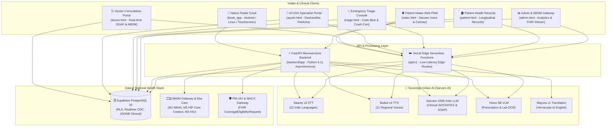

# 🏥 MediKiosk — AI-Powered Patient Case-Taking Software
### *Smart India Hackathon (SIH 2026) | Problem Statement ID: 26047*
**Ministry/Department:** All India Institute of Ayurveda (AIIA), Ministry of Ayush  
**Theme:** MedTech / HealthTech / BioTech • **Category:** Software  
**Architecture:** Hybrid Production Stack (Native Flutter Kiosk + 5+1 Web PWA Suite + FastAPI Python Microservices + Vercel Edge Serverless + Supabase Managed PostgreSQL + Sovereign Indic AI)

---

## 📌 Executive Summary & Problem Context

In Indian government tertiary hospitals and apex institutes (e.g., AIIMS, AIIA), outpatient departments (OPDs) register **4,000–10,000 patients daily**. A landmark study published in *BMJ Open (2017)* across 67 countries placed India's average primary-care consultation time at **just over 2 minutes**. 

Within this window, physicians must:
1. Elicit complex medical history across multiple regional languages and dialects.
2. Manually decipher crumpled, handwritten prior paper prescriptions and lab reports.
3. Perform physical examinations, assess Ayurveda's deep *Dashavidha Pariksha* (Prakriti, Vikriti, Agni, Koshtha), formulate diagnoses, and prescribe.

**MediKiosk** solves this "first-mile" clinical bottleneck. It is an autonomous, multimodal, self-service clinical intake platform that captures structured medical history through natural voice conversations in 11+ Indic languages, digitizes paper documents with Vision AI, flags emergency red-flags, and pushes standardized, physician-ready SOAP notes and FHIR bundles to the ABDM ecosystem before the patient enters the consultation room.

---

## 🏛️ System Architecture



---

## 📱 Dual-Client Intake Ecosystem

### 1. Native Flutter Hardware Kiosk (`kiosk_app/`)
* **Technology:** Flutter 3.x, Dart Null-Safety, Riverpod 2.x (code-gen), GoRouter, Clean Architecture.
* **Target Hardware:** OPD kiosk kiosks, Android tablets, touch displays, Linux terminals.
* **Capabilities:** 
  - Direct hardware device integration (Webcam/scanner, thermal printer for OPD tokens).
  - High-performance, offline-resilient local cache fallback.
  - Riverpod-driven conversational intake flow with zero layout jank.

### 2. 5+1 Unified Web Dashboard Suite
| Portal | Route | Target User | Key Capabilities |
| :--- | :--- | :--- | :--- |
| **1. Patient Intake Kiosk** | `/` (`index.html`) | Patients / Attendants | Multilingual voice (Sarvam AI), ABHA OTP/QR login, DPDPA 2023 audio consent, Vision OCR scan, Red-flag STAT triage |
| **2. Doctor Portal** | `/doctor` (`doctor.html`) | OPD Physicians | Real-time queue sync, native mother-tongue audio playback, standardized English SOAP notes, 1-Click ABDM M2 push |
| **3. Emergency Triage Console** | `/triage` (`triage.html`) | ER & Resuscitation Team | Zero-click emergency bypass, Code Blue & Crash Cart alerts, bed routing, real-time hemodynamic monitor |
| **4. AYUSH Portal** | `/ayush` (`ayush.html`) | Ayurvedic Vaidyas / Doctors | *Dashavidha Pariksha* radar charts (Prakriti, Agni, Koshtha), Panchakarma scheduling, NAMASTE & WHO TM-2 coding |
| **5. Patient Health Dashboard** | `/patient` (`patient.html`) | Patients at Home | Personal ID login, past encounter record access, pre-visit symptom check-in, cloud lab record uploader |
| **6. Admin & ABDM Gateway** | `/admin` (`admin.html`) | Hospital Administrators | Live FHIR transaction stream, PM-JAY claim ledger, OPD throughput analytics, national ABDM compliance |

---

## 🧠 Sovereign Indian AI Stack (100% Indigenous)

```
┌──────────────────────────────────────────────────────────────────────────────────────────────────┐
│                                   SOVEREIGN INDIC AI INTEGRATION                                 │
├──────────────────────────────────────────┬───────────────────────────────────────────────────────┤
│    AI MODEL / SERVICE                    │ FUNCTION & CLINICAL ROLE                              │
├──────────────────────────────────────────┼───────────────────────────────────────────────────────┤
│ • Sarvam-105B Indic LLM                  │ Adaptive clinical reasoning, SOCRATES symptom triage, │
│                                          │ SOAP note generation, and pharmacology suggestions.   │
│ • Sarvam Bulbul v3 TTS                   │ High-fidelity Indic voice output in 11 regional       │
│                                          │ languages (Telugu, Tamil, Kannada, Hindi, etc.).      │
│ • Sarvam Saaras v3 STT                   │ Robust vernacular speech-to-text with medical dialect │
│                                          │ adaptation across 22 Indian languages.               │
│ • Sarvam Mayura v1 Translation           │ Real-time medical translation of Indic vernacular     │
│                                          │ narrative into standardized clinical English.         │
│ • Sarvam Vision 3B VLM                   │ High-accuracy multi-document OCR for handwritten      │
│                                          │ prescriptions and laboratory biomarker extraction.    │
└──────────────────────────────────────────┴───────────────────────────────────────────────────────┘
```

---

## 🇮🇳 ABDM, FHIR R4 & Regulatory Compliance

* **ABDM Milestone 1 (M1):** Seamless ABHA ID verification, Aadhaar OTP authentication, and Instant ABHA QR card scanning.
* **ABDM Milestone 2 (M2 - HIP):** Automatic linking of digitized clinical encounters to the patient's Care Context and publishing to the Government Health Information Exchange.
* **ABDM Milestone 3 (M3 - HIU):** Consent-driven patient longitudinal health history pull.
* **NRCeS FHIR R4 Compliant:** Generates structured `bdl-11` compliant `Bundle` documents containing `Patient`, `Encounter`, `Condition`, `Observation`, and `MedicationRequest` resources.
* **AYUSH & Global Coding:** Integrated with **NAMASTE Morbidity Codes** and **WHO ICD-11 Traditional Medicine Module 2 (TM-2)** alongside standard ICD-10.
* **PM-JAY & NHCX Integration:** Instant insurance pre-check via NRCeS FHIR R4 `CoverageEligibilityRequest` against the National Health Claims Exchange.
* **DPDPA 2023 Aligned:** Multilingual, audio-guided, granular consent modal ensuring full legal compliance for low-literacy and elderly populations.

---

## 📁 Repository Structure

```
medikiosk-sih2026/
├── kiosk_app/                  # Native Flutter Kiosk (Clean Architecture, Riverpod, GoRouter)
│   ├── lib/
│   │   ├── core/               # Constants, theme, router, utilities
│   │   ├── features/intake/    # Patient voice intake, models, presentation
│   │   └── main.dart
│   └── pubspec.yaml
├── backend/                    # High-throughput Python FastAPI Microservices
│   ├── app/
│   │   ├── core/               # Configuration, security & Pydantic settings
│   │   ├── models/             # Pydantic v2 schemas (FHIR, Patients, Prescriptions)
│   │   ├── routers/            # AI, ABDM, Doctor, Documents, Intake, Insurance
│   │   ├── services/           # Sarvam AI drivers & external integrations
│   │   └── main.py             # FastAPI entrypoint
│   └── requirements.txt
├── api/v1/                     # Vercel Serverless Edge API Functions
│   ├── abdm/                   # Edge ABDM verification endpoints
│   ├── ai/                     # Edge AI proxies for Sarvam services
│   ├── doctor/                 # Edge prescription and queue handlers
│   └── documents/              # OCR prescription & lab uploads
├── docs/                       # Official Specifications & Jury Defense Suite
│   ├── MASTER_PRD.md           # Comprehensive Master PRD
│   ├── 01_PRODUCT_REQUIREMENTS_DOCUMENT.md
│   ├── 02_SYSTEM_ARCHITECTURE_AND_APIS.md
│   ├── 03_DATABASE_SCHEMA_AND_ERD.sql
│   ├── 04_ABDM_FHIR_AND_SECURITY_SPEC.md
│   ├── 05_DEVOPS_CICD_AND_DEPLOYMENT.md
│   ├── 06_SIH_PITCH_DECK_AND_DEMO_SCRIPT.md
│   ├── 07_REFERENCES_AND_CITATIONS.md
│   └── 08_TECH_STACK_AND_COMPATIBILITY.md
├── index.html                  # Portal 1: Patient Multimodal Intake Kiosk
├── doctor.html                 # Portal 2: Doctor Consultation & ABDM Export
├── triage.html                 # Portal 3: Emergency Nursing Triage Console
├── ayush.html                  # Portal 4: AYUSH Dashavidha Pariksha Portal
├── patient.html                # Portal 5: Patient Health Record Portal
├── admin.html                  # Portal 6: Hospital Administration & ABDM Gateway
├── SIH_2026_MediKiosk_Comprehensive_Jury_Report.pdf
├── SIH_2026_MediKiosk_Pitch_and_Jury_Defense_Manual.pdf
├── MediKiosk_SIH2026_Master_Pitch_and_50_Jury_QA.pdf
├── MediKiosk_SIH2026_Pitch.pptx
└── README.md
```

---

## 🚀 Quickstart & Local Development

### 1. Clone the Repository
```bash
git clone https://github.com/potlasrisharan/medikiosk-sih2026.git
cd medikiosk-sih2026
```

### 2. Environment Configuration
Create a `.env` file at root or configure your hosting provider:
```env
SUPABASE_URL=https://your-project.supabase.co
SUPABASE_KEY=your_supabase_anon_key
SARVAM_API_KEY=your_sarvam_api_key
ABDM_CLIENT_ID=your_abdm_client_id
ABDM_CLIENT_SECRET=your_abdm_client_secret
```

### 3. Run Web Portals & Edge Functions
```bash
# Install Web dependencies
npm install

# Run with Vercel CLI (recommended for full edge routing)
npx vercel dev

# OR run with any local HTTP server
python3 -m http.server 3000
```
- Patient Kiosk: `http://localhost:3000/`
- Doctor Portal: `http://localhost:3000/doctor`
- Emergency Triage: `http://localhost:3000/triage`
- AYUSH Portal: `http://localhost:3000/ayush`
- Patient Records: `http://localhost:3000/patient`
- Admin Gateway: `http://localhost:3000/admin`

### 4. Run Python FastAPI Backend
```bash
cd backend
python3 -m venv venv
source venv/bin/activate
pip install -r requirements.txt
uvicorn app.main:app --reload --port 8000
```
Interactive Swagger API docs available at `http://localhost:8000/docs`.

### 5. Run Native Flutter Kiosk App
```bash
cd kiosk_app
flutter pub get
flutter run -d macos  # or -d chrome, or connect an Android tablet
```

---

## 🏆 SIH 2026 Jury Defense & Evaluation Artifacts

* **Comprehensive Jury Report:** [SIH_2026_MediKiosk_Comprehensive_Jury_Report.pdf](SIH_2026_MediKiosk_Comprehensive_Jury_Report.pdf)
* **Jury Defense & Viva Manual:** [SIH_2026_MediKiosk_Pitch_and_Jury_Defense_Manual.pdf](SIH_2026_MediKiosk_Pitch_and_Jury_Defense_Manual.pdf)
* **Master Pitch & 50 Jury Q&A:** [docs/MediKiosk_SIH2026_Master_Pitch_and_50_Jury_QA.pdf](docs/MediKiosk_SIH2026_Master_Pitch_and_50_Jury_QA.pdf)
* **Master Pitch Presentation:** [MediKiosk_SIH2026_Pitch.pptx](MediKiosk_SIH2026_Pitch.pptx)
* **Master PRD:** [docs/MASTER_PRD.md](docs/MASTER_PRD.md)
* **PostgreSQL Production Schema:** [docs/03_DATABASE_SCHEMA_AND_ERD.sql](docs/03_DATABASE_SCHEMA_AND_ERD.sql)

---

## 👥 Contributors & Acknowledgements

* **Lead Architect & Developer:** Potla Sri Sharan
* **Problem Statement:** #26047 — *Patient Case-Taking Software*
* **Target Ministry:** Ministry of Ayush & All India Institute of Ayurveda (AIIA)
* **National Initiative:** Smart India Hackathon (SIH 2026)
