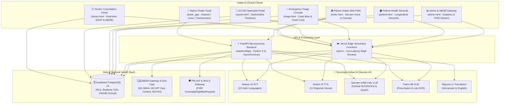

# 🏥 MediKiosk — AI-Powered Patient Case-Taking Software
### *Smart India Hackathon (SIH 2026) | Problem Statement ID: 26047*

[](https://www.sih.gov.in/)
[](https://aiia.gov.in/)
[](https://nrces.in/ndhm/fhir/r4/)
[](https://www.sarvam.ai/)
[](https://supabase.com/)
[](#)

> **Ministry/Department:** All India Institute of Ayurveda (AIIA), Ministry of Ayush  
> **Theme:** MedTech / HealthTech / BioTech • **Category:** Software  
> **Architecture:** Hybrid Production Stack (Native Flutter Touch Kiosk + 5+1 Web PWA Suite + FastAPI Python Microservices + Vercel Edge Serverless + Supabase Managed PostgreSQL + Sovereign Indic AI)

---

## 📌 1. Project Overview & Clinical Context

In Indian government tertiary hospitals and apex institutes (e.g., AIIMS, AIIA), outpatient departments (OPDs) register **4,000–10,000 patients daily**. A landmark study published in *BMJ Open (2017)* across 67 countries placed India's average primary-care consultation time at **just 2.1 minutes**.

Within this narrow window, physicians are burdened with three simultaneous cognitive loads:
1. Eliciting comprehensive medical histories across diverse regional languages and colloquial dialects.
2. Manually deciphering crumpled, handwritten past paper prescriptions and biomarker lab reports.
3. Conducting physical exams, scoring traditional Ayurveda clinical protocols (*Dashavidha Pariksha* — Prakriti, Vikriti, Agni, Koshtha), formulating differential diagnoses, and prescribing.

**MediKiosk** eliminates this first-mile bottleneck. It is an autonomous, multimodal, self-service clinical intake system that engages patients in natural voice conversations across 11+ Indic languages, digitizes handwritten prescriptions using Vision AI, detects critical red flags in under 150ms, and compiles verified [NRCeS-compliant HL7 FHIR R4](https://nrces.in/ndhm/fhir/r4/) bundles and standardized SOAP notes before the patient steps into the doctor's chamber.

### Key Capabilities
- **Multilingual Voice Intake:** Hands-free, conversational dialogue powered by Sarvam AI (`Saaras v3` STT & `Bulbul v3` TTS) in 11+ languages with regional dialect resilience.
- **Vision Document OCR:** Multi-document parsing extracting past medications, dosages, and abnormal lab biomarkers from crumpled physical paper.
- **Emergency Red-Flag Interceptor:** Real-time clinical safety engine that triggers visual and auditory Code Blue / STAT triage alerts under 150ms for chest pain, acute dyspnea, and neurological deficits.
- **AYUSH & Modern Integration:** Native support for Ayurvedic *Dashavidha Pariksha*, Prakriti radar profiling, and dual coding via **NAMASTE Morbidity Codes** and **WHO ICD-11 TM-2**.
- **ABDM Milestone 1, 2 & 3 Compliance:** Instant ABHA creation/verification via Aadhaar OTP/QR, automated HIP Care Context linking, and consent-managed longitudinal record retrieval.
- **National Health Claims Integration:** Real-time PM-JAY BIS coverage checks over the National Health Claims Exchange (NHCX) using FHIR `CoverageEligibilityRequest`.

---

## 🏛️ 2. System Architecture



### Request Lifecycle & Data Flow
1. **Patient Check-in:** Patient scans ABHA QR or creates ABHA using Aadhaar OTP on the Kiosk (Flutter or Web PWA).
2. **Vernacular Dialogue:** Patient speaks in their native tongue; audio streams to `Saaras v3` STT. `Sarvam-105B` conducts adaptive SOCRATES intake and responds via `Bulbul v3` voice synthesis.
3. **Safety Evaluation:** Every conversational turn runs through the Red-Flag Interceptor in `<150ms`. Emergencies trigger immediate alerts on `/triage`.
4. **Document Digitization:** Prior physical prescriptions are scanned and processed via `Vision 3B VLM`, outputting normalized active medications and flagged abnormal lab biomarkers.
5. **Real-time Clinical Synchronization:** Encounter state synchronizes into Supabase PostgreSQL over WebSockets/CDC.
6. **Physician Review & ABDM Export:** Doctor opens `/doctor` to review the pre-structured SOAP summary, validates diagnoses, and dispatches the signed FHIR R4 Bundle to the national ABDM network with one click.

---

## 🛠️ 3. Tech Stack

| Tier | Technologies |
| :--- | :--- |
| **Native Touch Kiosk** | **Flutter 3.x**, **Dart 3.x** (Strict Null Safety), **Riverpod** (Code-Gen), **GoRouter**, Clean Architecture |
| **Web Dashboards (PWA)** | Vanilla JavaScript (ES2023+), Tailwind CSS, Lucide Icons, WebRTC Audio, HTML5 Canvas Pain Mapping |
| **Microservices Backend** | **Python 3.11+**, **FastAPI**, **Uvicorn**, **Pydantic v2**, `httpx`, `python-dotenv` |
| **Serverless Edge Layer** | **Node.js 18+**, Vercel Edge Serverless Functions (`api/v1/`) |
| **Database & Realtime** | **Supabase Managed PostgreSQL 16**, Row Level Security (RLS), Realtime CDC replication, JSONB |
| **Sovereign Indian AI** | **Sarvam AI Suite**: `Saaras v3` (STT), `Bulbul v3` (TTS), `Mayura v1` (Translation), `Sarvam-105B` (LLM), `Vision 3B` (VLM) |
| **National Health Standards** | **NRCeS HL7 FHIR R4** (`bdl-11`), **ABDM M1 / M2 / M3**, **Eka Care Developer Gateway**, **NHCX / PM-JAY BIS**, **DPDPA 2023** |

---

## 🏛️ 4. The 5+1 Unified Dashboard Suite

| Portal | Route | Target User | Key Capabilities |
| :--- | :--- | :--- | :--- |
| **1. Patient Intake Kiosk** | `/` (`index.html`) | Patients / Attendants | Multilingual voice (Sarvam AI), ABHA OTP/QR login, DPDPA 2023 audio consent, Vision OCR scan, Red-flag STAT triage |
| **2. Doctor Portal** | `/doctor` (`doctor.html`) | OPD Physicians | Real-time queue sync, native mother-tongue audio playback, standardized English SOAP notes, 1-Click ABDM M2 push |
| **3. Emergency Triage Console** | `/triage` (`triage.html`) | ER & Resuscitation Team | Zero-click emergency bypass, Code Blue & Crash Cart alerts, bed routing, real-time hemodynamic monitor |
| **4. AYUSH Portal** | `/ayush` (`ayush.html`) | Ayurvedic Vaidyas / Doctors | *Dashavidha Pariksha* radar charts (Prakriti, Agni, Koshtha), Panchakarma scheduling, NAMASTE & WHO TM-2 coding |
| **5. Patient Health Dashboard** | `/patient` (`patient.html`) | Patients at Home | Personal ID login, past encounter record access, pre-visit symptom check-in, cloud lab record uploader |
| **6. Admin & ABDM Gateway** | `/admin` (`admin.html`) | Hospital Administrators | Live FHIR transaction stream, PM-JAY claim ledger, OPD throughput analytics, national ABDM compliance |

---

## 🗄️ 5. Database Schema & Data Models

The database runs on **PostgreSQL 16** managed via Supabase with full Row-Level Security (RLS). Complete DDL source is documented in [`docs/03_DATABASE_SCHEMA_AND_ERD.sql`](docs/03_DATABASE_SCHEMA_AND_ERD.sql).

```
facilities (hospitals & apex institutes)
├── id (UUID, PK)
├── facility_code (VARCHAR, UNIQUE)
└── facility_name, system_type, state, district

departments (OPD clinics & AYUSH units)
├── id (UUID, PK)
├── facility_id (UUID, FK → facilities)
└── name, code, is_ayush_specialty

patients (registered citizens)
├── id (UUID, PK)
├── abha_number (VARCHAR, UNIQUE)
├── abha_address (VARCHAR, UNIQUE)
├── name, gender, dob, mobile_hash
└── consent_dpdpa_timestamp, consent_audio_url

encounters (clinical intake sessions)
├── id (UUID, PK)
├── patient_id (UUID, FK → patients)
├── department_id (UUID, FK → departments)
├── session_status (INITIALIZED | IN_PROGRESS | COMPLETED | ABORTED)
├── triage_priority (ROUTINE | URGENT | EMERGENCY_RED)
└── chief_complaint, mother_tongue, intake_audio_url

symptoms_intake (granular SOCRATES assessment)
├── id (UUID, PK)
├── encounter_id (UUID, FK → encounters)
└── symptom_name, anatomical_site, onset, severity_score (1-10)

ayush_assessments (Dashavidha Pariksha & Prakriti)
├── id (UUID, PK)
├── encounter_id (UUID, FK → encounters)
├── prakriti_vata, prakriti_pitta, prakriti_kapha (0-100 radar)
├── agni_type (MANDA | TIKSHNA | VISHAMA | SAMA)
└── koshtha_type (KRURA | MRIDU | MADHYAMA)

extracted_medications & extracted_lab_observations (Vision OCR)
├── id (UUID, PK)
├── encounter_id (UUID, FK → encounters)
└── medication_name / test_name, value, unit, is_abnormal

clinical_summaries (physician notes & FHIR export)
├── id (UUID, PK)
├── encounter_id (UUID, FK → encounters)
├── subjective_text, objective_text, assessment_text, plan_text
├── fhir_bundle (JSONB - NRCeS bdl-11 document)
└── abdm_care_context_linked (BOOLEAN)
```

---

## 📋 6. Prerequisites

Ensure your workstation has the following installed:
- **Node.js**: `v18.x` or `v20.x LTS`
- **Python**: `3.10` or `3.11` (Python 3.11 recommended)
- **Flutter**: `3.19+` (Stable channel with Dart 3.3+)
- **Git**: `2.30+`
- **Browsers**: Modern Chromium-based browser (Chrome, Edge) or Safari for WebRTC audio testing.

---

## 🚀 7. Getting Started & Local Development

### Step 1: Clone Repository
```bash
git clone https://github.com/potlasrisharan/medikiosk-sih2026.git
cd medikiosk-sih2026
```

### Step 2: Environment Configuration
Create a `.env` file at the root or within `backend/`:
```bash
cp .env.example .env
```
Populate with valid credentials:
```env
SUPABASE_URL=https://your-project.supabase.co
SUPABASE_KEY=your_supabase_anon_key
SARVAM_API_KEY=your_sarvam_api_key
ABDM_CLIENT_ID=your_abdm_client_id
ABDM_CLIENT_SECRET=your_abdm_client_secret
```

### Step 3: Run Full Local Prototype (All-In-One Script)
The repository provides an automated startup script that launches both the FastAPI gateway and Web Portals simultaneously:
```bash
chmod +x start_prototype.sh
./start_prototype.sh
```
This serves:
- 📱 **Patient Intake Kiosk:** `http://localhost:3000`
- 🩺 **Doctor Consultation Portal:** `http://localhost:3000/doctor`
- 🌿 **AYUSH Dashavidha Hub:** `http://localhost:3000/ayush`
- 🚨 **Emergency Triage Console:** `http://localhost:3000/triage`
- 📊 **Admin & ABDM Console:** `http://localhost:3000/admin`
- ⚡ **FastAPI Gateway Swagger Docs:** `http://localhost:8000/docs`

---

### Step 4: Run Services Individually

#### Option A: Web Portals & Edge Functions
```bash
npm install
npx vercel dev
# OR run a lightweight local static server:
python3 -m http.server 3000 --directory public
```

#### Option B: Python FastAPI Microservices
```bash
cd backend
python3 -m venv venv
source venv/bin/activate
pip install -r requirements.txt
uvicorn app.main:app --host 0.0.0.0 --port 8000 --reload
```

#### Option C: Native Flutter Kiosk App
```bash
cd kiosk_app
flutter pub get
flutter run -d macos  # or -d chrome, or connect an Android tablet
```

---

## ⚙️ 8. Environment Variables Reference

| Variable | Required | Description | Example / Source |
| :--- | :---: | :--- | :--- |
| `SUPABASE_URL` | **Yes** | Supabase Project URL | `https://xyzcompany.supabase.co` |
| `SUPABASE_KEY` | **Yes** | Supabase Anonymous Public API Key | `eyJhbGciOiJIUzI1NiIsInR5c...` |
| `SARVAM_API_KEY` | **Yes** | Sarvam AI Production API Key | [Sarvam Dashboard](https://dashboard.sarvam.ai) |
| `ABDM_CLIENT_ID` | Optional | NHA / Eka Care Sandbox Client ID | [Eka Developer Portal](https://developer.eka.care/) |
| `ABDM_CLIENT_SECRET`| Optional | NHA / Eka Care Sandbox Secret | [Eka Developer Portal](https://developer.eka.care/) |
| `RED_FLAG_TIMEOUT_MS` | Optional | Critical Triage Interceptor SLA | `150` (default) |
| `DEFAULT_HOSPITAL_NAME`| Optional | Hospital / Institute Label | `All India Institute of Ayurveda (AIIA)` |
| `DEFAULT_HOSPITAL_ID` | Optional | National Health Facility Registry (HFR) Code | `IN0110000142` |

---

## 💻 9. Available Scripts & Commands

| Scope | Command | Description |
| :--- | :--- | :--- |
| **Prototype** | `./start_prototype.sh` | Launches both FastAPI (:8000) and Web Suite (:3000) concurrently |
| **Web** | `npm install` | Installs frontend NPM dependencies (`@supabase/supabase-js`, etc.) |
| **Web** | `npx vercel dev` | Runs Vercel edge functions and web dashboards locally |
| **Backend** | `pip install -r backend/requirements.txt` | Installs Python FastAPI dependencies |
| **Backend** | `uvicorn backend.app.main:app --reload --port 8000` | Runs FastAPI server with live code reload |
| **Backend** | `pytest backend/tests/test_clinical_gateway.py` | Runs clinical gateway integration tests |
| **Flutter** | `flutter pub get` | Fetches Flutter packages in `kiosk_app/` |
| **Flutter** | `flutter analyze` | Runs Dart static analysis across the kiosk codebase |
| **Flutter** | `flutter test` | Executes Flutter unit and widget test suite |
| **Flutter** | `flutter build apk --release` | Compiles release APK for Android kiosk hardware |

---

## 🧪 10. Testing Guide

### 1. Backend Microservices Testing
Automated integration tests verify ABHA authentication, PM-JAY eligibility queries, <150ms red-flag triggering, Vision OCR extraction, and NRCeS FHIR R4 document structure:
```bash
pytest backend/tests/test_clinical_gateway.py -v
```
Sample test coverage output:
```
test_root_endpoint                     PASSED [ 14%]
test_abha_verification                 PASSED [ 28%]
test_insurance_eligibility             PASSED [ 42%]
test_red_flag_interceptor (<150ms)     PASSED [ 57%]
test_document_ocr_extraction           PASSED [ 71%]
test_doctor_queue_and_soap             PASSED [ 85%]
test_nrces_fhir_bundle (bdl-11)        PASSED [100%]
```

### 2. Flutter Kiosk Quality Suite
```bash
cd kiosk_app
flutter test
flutter analyze
```

---

## 🚢 11. Production Deployment

### 1. Web Suite & Edge APIs (Vercel)
The repository is configured for automated Vercel deployment:
```bash
vercel --prod
```
Set `SUPABASE_URL`, `SUPABASE_KEY`, and `SARVAM_API_KEY` in the Vercel Project Environment Variables.

### 2. FastAPI Python Backend (Docker / Cloud Run / VPS)
A lightweight production containerization pattern:
```dockerfile
FROM python:3.11-slim
WORKDIR /app
COPY backend/requirements.txt .
RUN pip install --no-cache-dir -r requirements.txt
COPY backend/app ./app
EXPOSE 8000
CMD ["uvicorn", "app.main:app", "--host", "0.0.0.0", "--port", "8000", "--workers", "4"]
```

### 3. Native Flutter Kiosk (Android Hardware APK)
Compile a high-performance, obfuscated release APK for Android kiosk terminals:
```bash
cd kiosk_app
flutter build apk --release --obfuscate --split-debug-info=build/debug-info
```

---

## 🔧 12. Troubleshooting

### 1. Browser Microphone Access Blocked
- **Symptom:** Voice intake button shows error or does not start recording.
- **Fix:** WebRTC requires HTTPS or `http://localhost`. Open browser settings -> Site Permissions -> Microphone -> Allow `localhost:3000`.

### 2. Sarvam AI Authentication Failures (401 / 403)
- **Symptom:** Voice STT transcription or TTS playback returns blank audio.
- **Fix:** Verify `SARVAM_API_KEY` in `.env`. Ensure your account has active credits in the [Sarvam Dashboard](https://dashboard.sarvam.ai).

### 3. Supabase Row Level Security (RLS) Permission Denied
- **Symptom:** Real-time queue on `/doctor` shows 0 patients or insert fails on `/`.
- **Fix:** Execute [`docs/03_DATABASE_SCHEMA_AND_ERD.sql`](docs/03_DATABASE_SCHEMA_AND_ERD.sql) in your Supabase SQL Editor to initialize all tables, enums, and permissive RLS intake policies.

### 4. Port 8000 or 3000 Already in Use
- **Symptom:** `start_prototype.sh` reports `Address already in use`.
- **Fix:** Free the occupied ports:
  ```bash
  lsof -ti:3000,8000 | xargs kill -9
  ```

---

## 🏆 13. SIH 2026 Jury Defense & Evaluation Artifacts

* **Comprehensive Master PRD:** [`docs/MASTER_PRD.md`](docs/MASTER_PRD.md)
* **Comprehensive Jury Report:** [`SIH_2026_MediKiosk_Comprehensive_Jury_Report.pdf`](SIH_2026_MediKiosk_Comprehensive_Jury_Report.pdf)
* **Jury Defense & Viva Manual:** [`SIH_2026_MediKiosk_Pitch_and_Jury_Defense_Manual.pdf`](SIH_2026_MediKiosk_Pitch_and_Jury_Defense_Manual.pdf)
* **Master Pitch & 50 Jury Q&A:** [`docs/MediKiosk_SIH2026_Master_Pitch_and_50_Jury_QA.pdf`](docs/MediKiosk_SIH2026_Master_Pitch_and_50_Jury_QA.pdf)
* **Master Pitch Presentation Deck:** [`MediKiosk_SIH2026_Pitch.pptx`](MediKiosk_SIH2026_Pitch.pptx)
* **PostgreSQL Production DDL Schema:** [`docs/03_DATABASE_SCHEMA_AND_ERD.sql`](docs/03_DATABASE_SCHEMA_AND_ERD.sql)
* **ABDM FHIR R4 & Security Specification:** [`docs/04_ABDM_FHIR_AND_SECURITY_SPEC.md`](docs/04_ABDM_FHIR_AND_SECURITY_SPEC.md)

---

## 👥 14. Contributors & Acknowledgements

* **Lead Architect & Developer:** [Potla Sri Sharan](https://github.com/potlasrisharan)
* **Problem Statement:** #26047 — *AI-Powered Patient Case-Taking Software*
* **Target Ministry:** Ministry of Ayush & All India Institute of Ayurveda (AIIA)
* **National Initiative:** Smart India Hackathon (SIH 2026)
